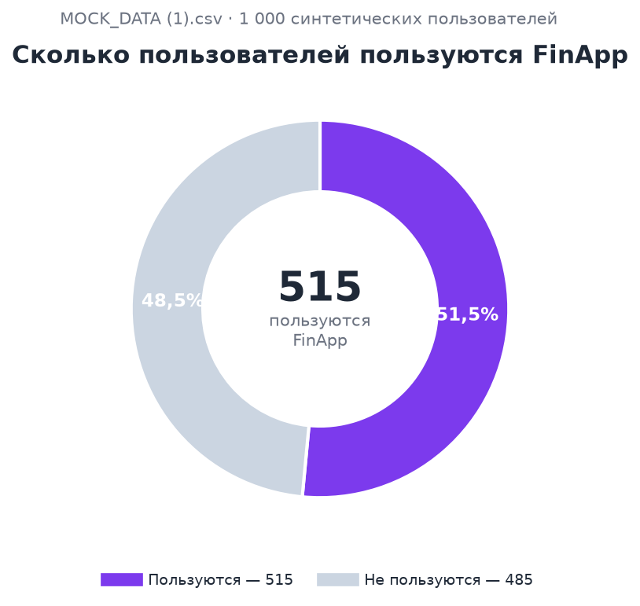
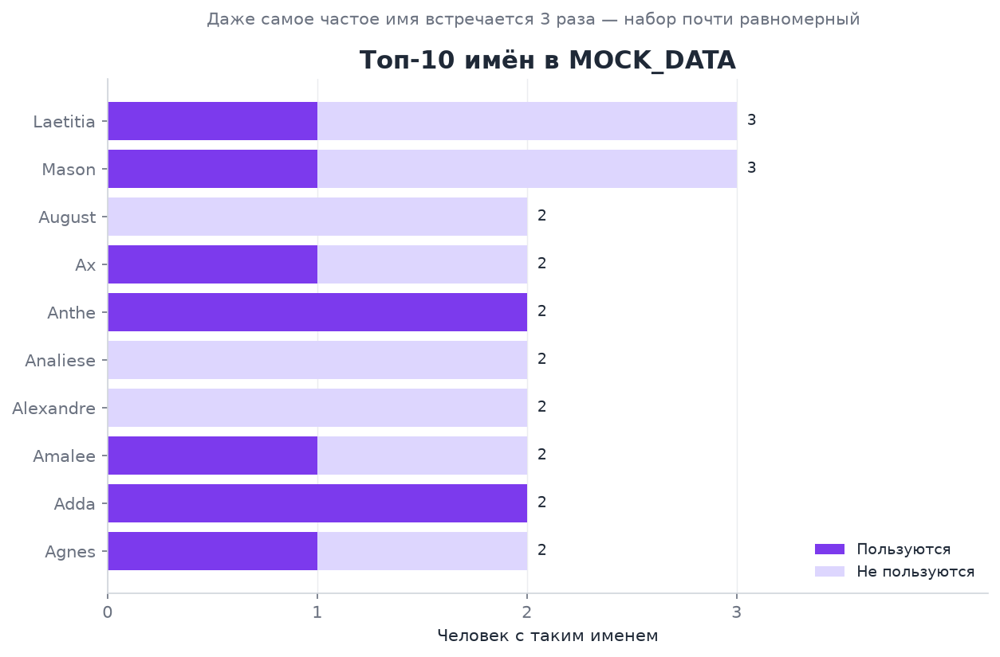
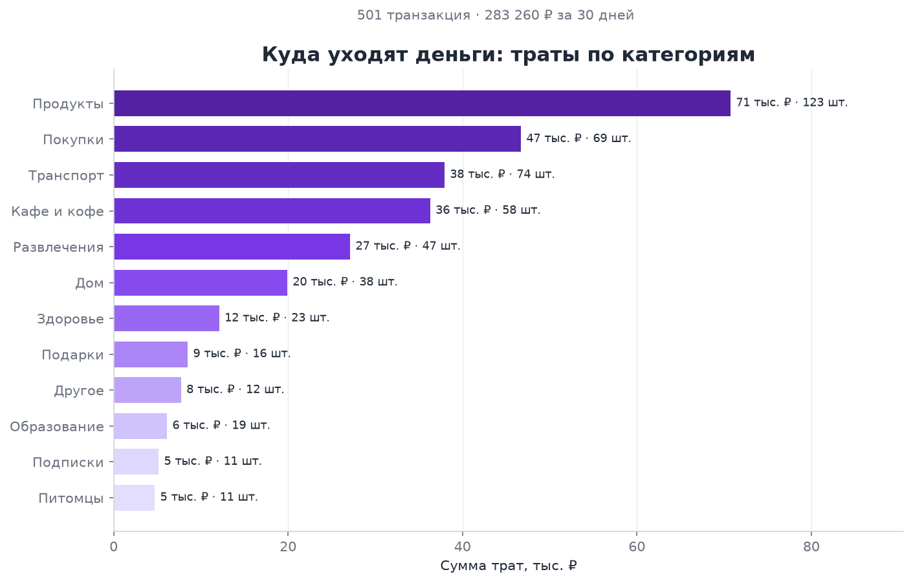
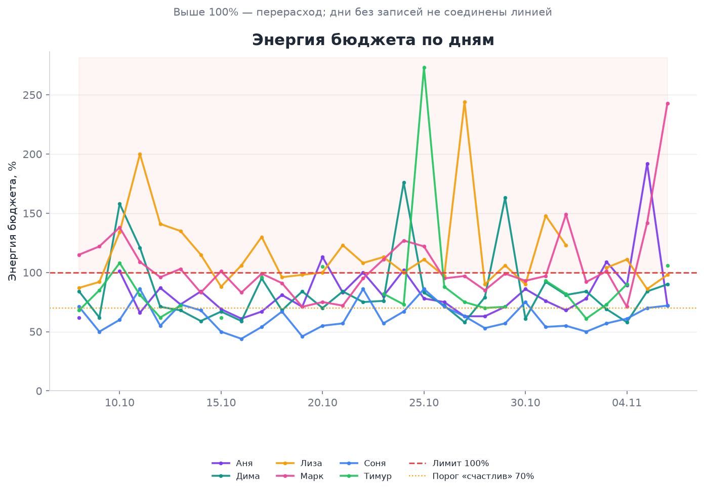
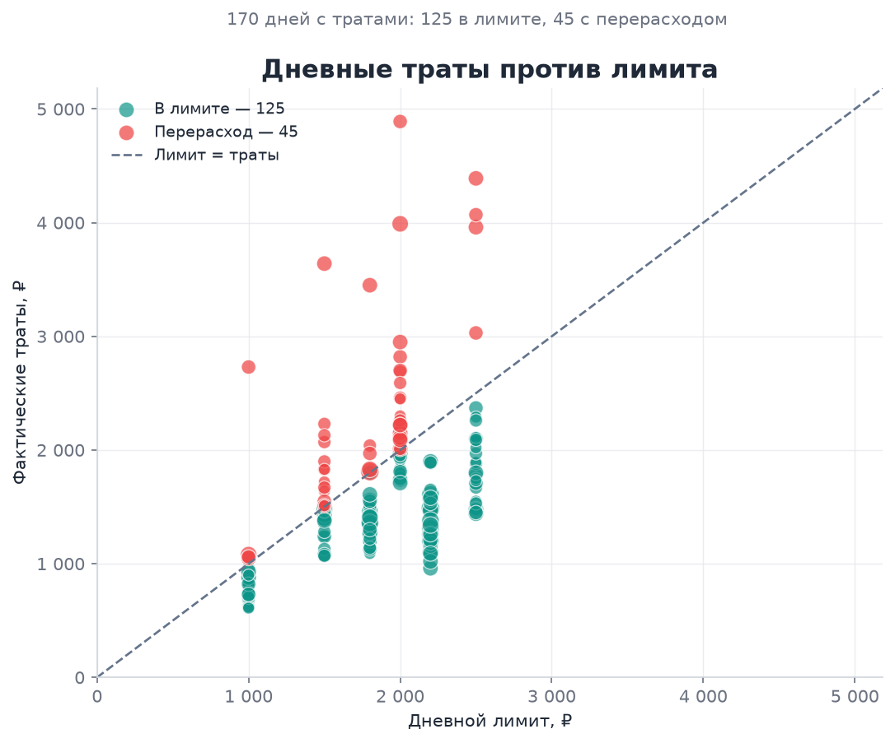
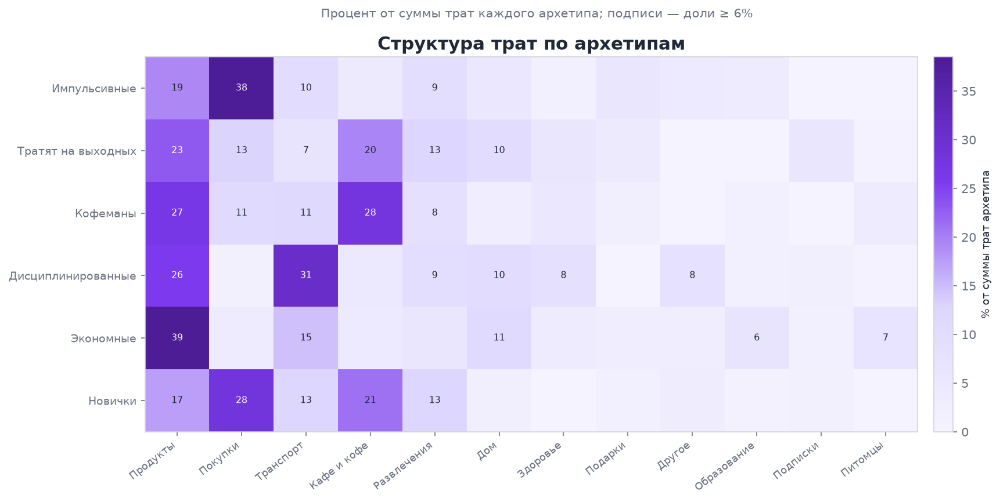
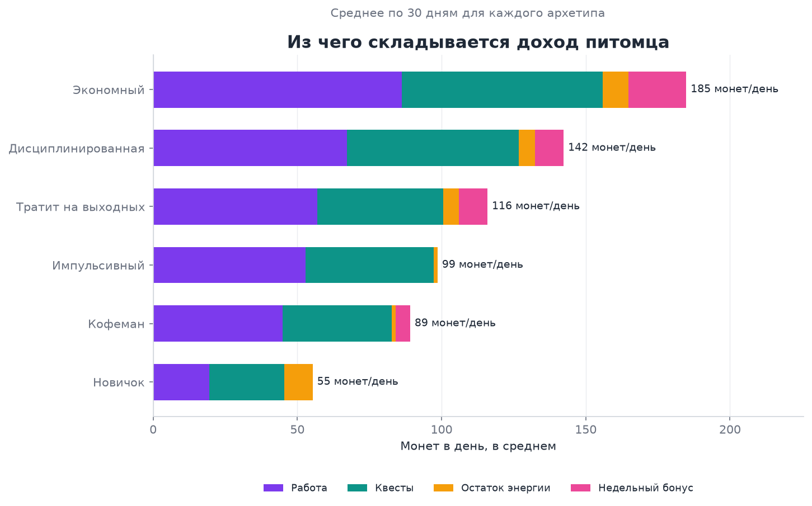
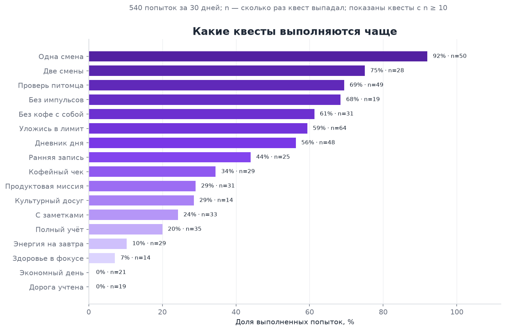
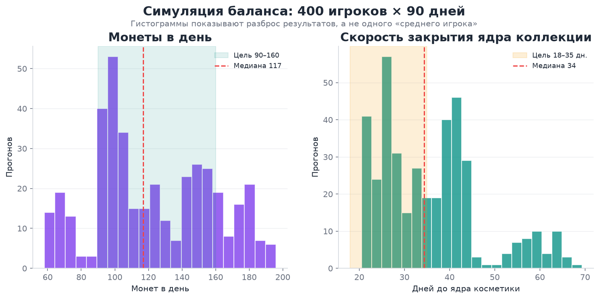
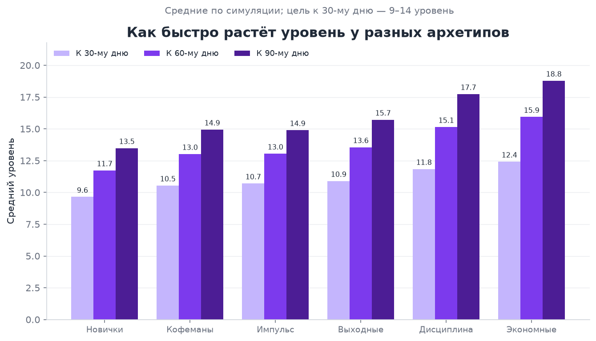

# Анализ данных FinGame

**Дата анализа:** 24.11.2026  
**Источники:** `MOCK_DATA (1).csv` из репозитория и синтетические данные игрового прототипа `financial-tamagotchi/`  
**Инструменты:** Python, pandas, numpy, matplotlib

> Все данные синтетические. Это учебный анализ, а не исследование реальных людей и не финансовый совет.

---

## 1. Если вы не занимаетесь анализом данных

Анализ данных — это не «магия с графиками». Это последовательность из пяти шагов:

1. **Понять, что лежит в таблицах.** Какая строка что описывает: человек, трата, день, игровой прогон?
2. **Проверить качество.** Есть ли пропуски, дубли, странные суммы, битые даты?
3. **Посчитать сводные показатели.** Сколько всего, сколько в среднем, медиана, минимум и максимум.
4. **Сравнить группы и посмотреть динамику.** Например, траты по категориям, дни в лимите, поведение архетипов.
5. **Сделать выводы с оговорками.** Что данные действительно показывают, а что им только приписывают.

Главный вывод этого отчёта: **два набора данных описывают разные вещи и не склеиваются между собой**. `MOCK_DATA` — это 1 000 синтетических пользователей с одним флагом «пользуется FinApp». Данные прототипа — это 6 игровых пользователей, 501 трата и 180 игровых дней. Поэтому анализ идёт по каждому набору отдельно, а затем собирается общая картина.

### Пять главных цифр

| Показатель | Значение | Источник |
|---|---:|---|
| Пользователей в MOCK_DATA | 1 000 | `MOCK_DATA (1).csv` |
| Из них пользуются FinApp | 51,5% | `MOCK_DATA (1).csv` |
| Транзакций в игровом наборе | 501 | `transactions.csv` |
| Дней в лимите (активные дни) | 73,5% | `mock_users.json` |
| Медианный доход в симуляции | 117 монет/день | `balance_runs.csv` |

---

## 2. Какие данные есть

| Набор | Что описывает одна строка | Размер | Сильные поля | Ограничение |
|---|---|---|---:|---|---|
| `MOCK_DATA (1).csv` | пользователь | 1 000 | имя, флаг `Using finapp` | нет трат, дат и финансового поведения |
| `transactions.csv` | одна трата | 501 | дата, сумма, категория, лимит, пользователь | всего 6 пользователей |
| `mock_users.json` → дни | один игровой день | 180 | энергия, здоровье, стрики, XP, монеты, квесты | синтетическая модель, а не живые люди |
| `balance_runs.csv` | один прогон симуляции на 90 дней | 400 | уровень, доход, доля дней в лимите, сроки коллекции | это математическая модель, а не A/B-тест |

### Проверка качества

| Набор | Строк | Колонок | Пропусков в обязательных | Пропусков в необязательных | Дублей id | Вердикт |
| :--- | ---: | ---: | ---: | ---: | ---: | :--- |
| MOCK_DATA (1).csv | 1 000 | 4 | 0 | 0 | 0 | чисто, но мало полей |
| transactions.csv | 501 | 10 | 0 | 289 | 0 | готово; заметки опциональны |
| mock_users.json → дни | 180 | 24 | 0 | 0 | 0 | готово к анализу |
| balance_runs.csv | 400 | 19 | 0 | 19 | 0 | 19 NaN в dayTo6000 — не ошибка |

**Что проверяли:** пропущенные значения, полные дубли строк, повторяющиеся идентификаторы и невозможные значения (например, отрицательная сумма траты или здоровье вне 0–100). В игровых данных пропуски в заметках — это нормально: заметка необязательна. В `MOCK_DATA` пропусков нет, но и полей для глубокого анализа почти нет.

### Почему наборы нельзя просто «склеить»

- В `MOCK_DATA` нет `user_id`, который совпадал бы с `u_001…u_006`.
- В `MOCK_DATA` нет дат, сумм и категорий трат.
- Игровые пользователи — вымышленные персонажи с архетипами, а не те же люди из `MOCK_DATA`.
- Любое объединение по имени было бы случайным совпадением.

Поэтому дальше: сначала отдельно `MOCK_DATA`, потом отдельно игровые данные, потом — общая сводка метрик.

---

## 3. Набор A: `MOCK_DATA (1).csv`

| Имя | Человек |
| :--- | ---: |
| Laetitia | 3 |
| Mason | 3 |
| Richard | 2 |
| Nedda | 2 |
| Adda | 2 |
| Yank | 2 |
| Blinnie | 2 |
| Keen | 2 |
| Inigo | 2 |
| Tessi | 2 |



> **Что это значит.** Из 1 000 строк 515 помечены как пользователи FinApp, 485 — как не пользующиеся. Это 51,5%. Но это мок-данные генератора, а не репрезентативная выборка рынка.




> **Что это значит.** Даже самое частое имя встречается всего 3 раза. Набор выглядит почти равномерно сгенерированным: в нём нет естественных демографических перекосов, поэтому имена здесь почти не несут аналитической ценности.


**Что можно сказать честно:** `MOCK_DATA` подходит как заготовка для демонстрации списка пользователей или тестирования интерфейса. Для анализа финансового поведения в нём не хватает главного — самих финансовых действий.

---

## 4. Набор B: траты игровых пользователей

### 4.1 Общая картина

| Показатель | Значение |
|---|---:|
| Всего транзакций | 501 |
| Суммарные траты | 283 260 ₽ |
| Средний чек | 565 ₽ |
| Медианный чек | 410 ₽ |
| Минимальная трата | 40 ₽ |
| Максимальная трата | 2 490 ₽ |
| Дней с тратами | 170 из 180 |
| Дней без трат | 10 |
| Дней с перерасходом | 45 |
| Дней в лимите (среди активных) | 125 (73,5%) |

Средний чек (565 ₽) заметно выше медианного (410 ₽). Это значит, что распределение трат смещено вправо: большинство чеков небольшие, но есть крупные покупки, которые тянут среднее вверх. Для таких данных медиана часто честнее среднего.



> **Что это значит.** Больше всего денег уходит на продукты, покупки и транспорт. При этом количество транзакций и сумма — разные вещи: в категории может быть много мелких чеков, а в другой — несколько крупных.


### 4.2 Траты по категориям

| Категория | Трат | Сумма | Средний чек | Доля суммы |
| :--- | ---: | ---: | ---: | ---: |
| Продукты | 123 | 70 750 ₽ | 575 ₽ | 25,0% |
| Покупки | 69 | 46 720 ₽ | 677 ₽ | 16,5% |
| Транспорт | 74 | 37 960 ₽ | 513 ₽ | 13,4% |
| Кафе и кофе | 58 | 36 320 ₽ | 626 ₽ | 12,8% |
| Развлечения | 47 | 27 140 ₽ | 577 ₽ | 9,6% |
| Дом | 38 | 19 930 ₽ | 524 ₽ | 7,0% |
| Здоровье | 23 | 12 130 ₽ | 527 ₽ | 4,3% |
| Подарки | 16 | 8 510 ₽ | 532 ₽ | 3,0% |
| Другое | 12 | 7 750 ₽ | 646 ₽ | 2,7% |
| Образование | 19 | 6 130 ₽ | 323 ₽ | 2,2% |
| Подписки | 11 | 5 180 ₽ | 471 ₽ | 1,8% |
| Питомцы | 11 | 4 740 ₽ | 431 ₽ | 1,7% |

### 4.3 Пользователи

| Имя | Архетип | Трат | Потрачено | Дней в лимите | Уровень | Монеты |
| :--- | :--- | ---: | ---: | ---: | ---: | ---: |
| Аня | Дисциплинированные | 101 | 43 570 ₽ | 80,0% | 13 | 5 511 монет |
| Марк | Кофеманы | 72 | 47 640 ₽ | 56,7% | 10 | 3 195 монет |
| Лиза | Импульсивные | 83 | 67 440 ₽ | 33,3% | 10 | 3 820 монет |
| Дима | Тратят на выходных | 69 | 63 770 ₽ | 86,7% | 11 | 4 979 монет |
| Тимур | Новички | 50 | 19 760 ₽ | 60,0% | 7 | 1 841 монет |
| Соня | Экономные | 126 | 41 080 ₽ | 100,0% | 14 | 7 946 монет |



> **Что это значит.** Энергия — это процент потраченного дневного лимита. Линии выше 100% означают перерасход. Видно, что у разных архетипов разные паттерны: кто-то держится ровно, кто-то регулярно «взрывает» лимит.




> **Что это значит.** Точки ниже пунктирной линии — дни в лимите, выше — перерасход. Из 170 активных дней 125 были в лимите, а 45 — с перерасходом. Размер точки — число трат за день.


### 4.4 Категории по архетипам



> **Что это значит.** Тепловая карта показывает не абсолютные суммы, а доли внутри каждого архетипа. Так честнее сравнивать: у всех разный дневной лимит и разная сумма трат. Например, у кофеманов ожидаемо выше доля кафе, а у экономных — продуктов.


---

## 5. Игровая экономика

### 5.1 Доход питомца



> **Что это значит.** Основной источник монет — работа, затем квесты. Остаток энергии и недельный бонус дают меньший, но заметный вклад. Это значит, что игрок не обязан быть идеально дисциплинированным, чтобы получать доход: база работает всегда.


| Показатель | Значение |
|---|---:|
| Средние монеты в день (6 пользователей) | 114 |
| Средний XP в день | 65 |
| Среднее здоровье | 84 / 100 |
| Доля дней в лимите (все дни) | 69,4% |
| Выполнено попыток квестов | 252 из 540 |
| Среднее выполнение квестов в день | 1,40 из 3 |

### 5.2 Квесты

| Квест | Выпадал | Выполнен | Доля |
| :--- | ---: | ---: | ---: |
| Итоги недели | 1 | 1 | 100,0% |
| Одна смена | 50 | 46 | 92,0% |
| Две смены | 28 | 21 | 75,0% |
| Проверь питомца | 49 | 34 | 69,4% |
| Без импульсов | 19 | 13 | 68,4% |
| Без кофе с собой | 31 | 19 | 61,3% |
| Уложись в лимит | 64 | 38 | 59,4% |
| Дневник дня | 48 | 27 | 56,2% |
| Экономный день | 21 | 0 | 0,0% |
| Дорога учтена | 19 | 0 | 0,0% |
| Здоровье в фокусе | 14 | 1 | 7,1% |
| Энергия на завтра | 29 | 3 | 10,3% |
| Полный учёт | 35 | 7 | 20,0% |
| С заметками | 33 | 8 | 24,2% |



> **Что это значит.** Самые выполняемые квесты — простые действия: одна смена работы, проверка питомца, запись трат. Самые сложные — «Экономный день» и «Дорога учтена»: в этой симуляции они не выполняются ни разу. Это сигнал пересмотреть условия или награду, а не вину игрока.


---

## 6. Симуляция баланса: 400 игроков × 90 дней

Симуляция — это не реальные люди. Это способ проверить, как математика игры ведёт себя на разных стилях поведения. 400 прогонов помогают увидеть не только среднее, но и разброс.

### 6.1 Перцентили

| Метрика | p10 | p50 (медиана) | p90 |
| :--- | ---: | ---: | ---: |
| Монет в день | 73 | 117 | 177 |
| XP в день | 44 | 61 | 97 |
| Уровень к 30-му дню | 8 | 11 | 14 |
| Уровень к 90-му дню | 13 | 16 | 19 |
| Доля дней в лимите | 32,5% | 78,5% | 96,6% |
| Лучший стрик учёта | 23 | 56 | 94 |
| Лучший бюджетный стрик | 4 | 11 | 41 |
| Дней до ядра косметики | 23 | 34 | 55 |
| Дней до полной коллекции | 84 | 128 | 205 |
| Здоровье питомца | 16 | 100 | 100 |

### 6.2 Проверка целевых коридоров

| Цель | Коридор | Факт (медиана) | Попала? | Доля прогонов в коридоре |
| :--- | ---: | ---: | :--- | ---: |
| Средние монеты в день | 90–160 | 117 | да | 70% |
| Дней до ядра косметики | 18–35 | 34 | да | 52% |
| Дней до полной коллекции | 90–150 | 128 | да | 54% |
| Доля дней с перерасходом | 15,0%–35,0% | 21,5% | да | 25% |
| Уровень к 30-му дню | 9–14 | 11 | да | 82% |



> **Что это значит.** Гистограммы показывают, что «средний игрок» — это упрощение. Даже в одной модели результаты сильно различаются: часть прогонов выходит за целевой коридор. Именно поэтому баланс проверяют по перцентилям, а не только по среднему.


### 6.3 По архетипам

| Архетип | Монет/день | XP/день | Уровень к 30-му | Дней в лимите | Дней до ядра | Здоровье |
| :--- | ---: | ---: | ---: | ---: | ---: | ---: |
| Экономные | 178 | 98 | 12.4 | 97,7% | 23 | 99 |
| Дисциплинированные | 151 | 86 | 11.8 | 91,2% | 27 | 99 |
| Тратят на выходных | 121 | 63 | 10.9 | 79,4% | 33 | 98 |
| Кофеманы | 99 | 54 | 10.5 | 51,3% | 41 | 82 |
| Импульсивные | 98 | 52 | 10.7 | 31,8% | 41 | 17 |
| Новички | 68 | 41 | 9.6 | 69,9% | 59 | 96 |



> **Что это значит.** Дисциплинированные и экономные растут быстрее, импульсивные — медленнее, но всё равно доходят до жизнеспособного уровня. Это хороший признак: игра не «выключает» игрока за плохую дисциплину.


### 6.4 Корреляции

| Пара | Корреляция r |
| :--- | ---: |
| Дисциплина ↔ монеты | +0.73 |
| Дисциплина ↔ здоровье | +0.83 |
| Монеты ↔ уровень к 30-му дню | +0.47 |
| Монеты ↔ здоровье | +0.40 |

**Как читать:** коэффициент корреляции от −1 до +1. Чем ближе к +1, тем сильнее две метрики растут вместе. Но это **не доказательство причины и следствия**. В нашей модели дисциплина напрямую увеличивает монеты и здоровье, поэтому связь ожидаема. На реальных людях такая корреляция могла бы объясняться третьим фактором, например доходом.

---

## 7. Общая картина по всем данным

| Метрика | Значение | Источник | Как трактовать |
| :--- | ---: | :--- | :--- |
| Пользователей в MOCK_DATA | 1 000 | MOCK_DATA | демо-список, не финансы |
| Доля Using finapp | 51,5% | MOCK_DATA | можно использовать только как заглушку |
| Игровых пользователей | 6 | mock_users.json | маленькая выборка для демонстрации |
| Транзакций | 501 | transactions.csv | основной массив для анализа трат |
| Средний чек | 565 ₽ | transactions.csv | смещён крупными покупками |
| Медианный чек | 410 ₽ | transactions.csv | типичная трата |
| Доля активных дней в лимите | 73,5% | mock_users.json | дисциплина в игровом наборе |
| Медиана монет/день | 117 | balance_runs.csv | результат модели, не люди |
| Медиана дней до ядра | 34 | balance_runs.csv | длина ранней коллекции |
| Медиана дней до полной коллекции | 128 | balance_runs.csv | долгая цель |

### Что бы я добавил, чтобы анализ стал сильнее

1. **Единый `user_id` во всех таблицах.** Тогда можно связать пользователя, его траты и игровое состояние.
2. **Даты и события в `MOCK_DATA`.** Без них нельзя смотреть динамику и retention.
3. **Реальные (или хотя бы правдоподобные) транзакции.** Не только флаг «пользуется приложением».
4. **События продукта:** открытие, запись траты, завершение дня, покупка, уход.
5. **Когорты:** дата регистрации, канал привлечения, эксперимент A/B.
6. **Больше пользователей в игровом наборе.** 6 человек — это иллюстрация, а не статистика.

---

## 8. Ограничения анализа

- **Синтетика.** Все игровые пользователи и траты сгенерированы по правилам, а не собраны с людей.
- **Маленькая выборка.** 6 игровых пользователей и 30 дней не дают статистической значимости.
- **Нет причинности.** Корреляции в симуляции — следствие заложенных формул.
- **MOCK_DATA не про финансы.** Там нет сумм, категорий и дат.
- **Наборы не связаны.** Нельзя утверждать, что 51,5% из `MOCK_DATA` — это аудитория игры.
- **Средние обманчивы.** Поэтому в отчёте есть медианы, перцентили и разброс.

---

## 9. Как воспроизвести

```powershell
python -m pip install -r analysis/requirements.txt
python analysis/analyze.py
```

Скрипт пересоберёт:

- `analysis/figures/*.png` — графики;
- `analysis/output/*.csv` — сводные таблицы;
- `analysis/output/summary.json` — ключевые цифры;
- `analysis/report.md` — этот отчёт;
- `analysis/dashboard.html` — автономный дашборд с графиками.

---

## 10. Итог одной фразой

Данные прототипа показывают, что игровая петля собирает траты, дисциплину, награды и прогресс в одну систему; `MOCK_DATA` показывает только демографическую заглушку. Сильнее всего анализ улучшит не новый график, а **связка данных по пользователю и событиям**.
